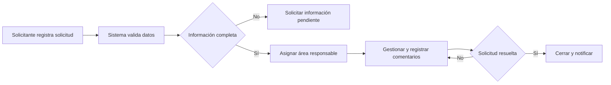

# Ejemplo patrón general para IA nube e IA local

## Propósito

Este documento define un ejemplo funcional común para evaluar la generación de
borradores con IA nube e IA local. Aplica a todos los proyectos y a todos los
perfiles de plantilla. No contiene información de un proyecto real.

La IA nube se toma como referencia del resultado funcional esperado. La IA
local debe alcanzar la misma cobertura, coherencia, trazabilidad y utilidad
para revisión humana. No se exige que ambos proveedores usen las mismas frases
ni el mismo JSON interno.

La comparación se realiza sobre el documento `DRAFT` después de aplicar el
resultado:

- IA nube puede producir el contrato canónico `AiAnalysisDraft 4.1.0`.
- IA local puede producir el contrato dinámico `LOCAL_ONLY_V2`.
- Ambos deben alimentar las mismas secciones del documento, en el mismo orden.
- Todas las secciones visibles deben poder revisarse y editarse humanamente.
- Ningún proveedor puede inventar información ni aprobar el documento.

## Cómo usar esta referencia

Este ejemplo sirve para:

1. revisar manualmente un borrador generado;
2. comparar IA local con IA nube sin depender de un proyecto específico;
3. construir pruebas funcionales y criterios de aceptación;
4. detectar omisiones, duplicados, exceso de texto o información inventada;
5. validar cambios de modelo, prompt, parser o plantilla.

No debe usarse como texto fijo para todos los proyectos. Cada borrador debe
estar sustentado únicamente en sus propias fuentes.

## Caso sintético de entrada

Para ilustrar el resultado esperado se usa la siguiente necesidad ficticia:

> Una organización recibe solicitudes internas por correo y hojas de cálculo.
> Necesita registrarlas en un único sistema, asignarlas por área, controlar sus
> estados, conservar comentarios y evidencias, medir tiempos de atención y
> notificar al solicitante. El acceso depende del rol. No se han confirmado la
> fecha de inicio, la capacidad del equipo ni el canal definitivo de
> notificación.

Fuentes hipotéticas disponibles:

- conversación con el solicitante;
- cuestionario de análisis con respuestas;
- nota que describe los estados actuales;
- lista de roles y reglas de acceso.

## Resultado funcional esperado

### 1. Encabezado del documento (`header`)

Debe contener título, código, versión, área solicitante y estado del documento.
No debe inventar responsables ni incluir aprobación en el encabezado.

Ejemplo resumido:

```text
Título: Gestión centralizada de solicitudes internas
Código: [PENDIENTE POR DEFINIR]
Versión: versión vigente del borrador
Área solicitante: Operaciones
Estado: Borrador
```

### 2. Objetivos del proyecto (`objectives`)

Debe separar el objetivo general de los objetivos específicos. Los objetivos
cuantitativos solo pueden incluir valores confirmados por las fuentes.

Ejemplo resumido:

```text
Objetivo general: Centralizar el registro, asignación y seguimiento de las
solicitudes internas.

Objetivos específicos:
- Conservar el historial de estados, comentarios y evidencias.
- Permitir seguimiento por solicitante, responsable y área.
- Medir los tiempos de atención con datos verificables.
- Meta numérica: [PENDIENTE POR DEFINIR].
```

### 3. Descripción del problema (`problemDescription`)

Debe explicar el estado actual, las causas documentadas, los usuarios
afectados y los impactos operativos. No debe repetir literalmente todas las
fuentes.

Ejemplo resumido:

```text
Las solicitudes se reciben por canales separados y se controlan en archivos
independientes. Esto dificulta conocer el responsable, el estado vigente y el
tiempo transcurrido, y aumenta el riesgo de pérdida de evidencias y seguimiento.
```

### 4. Alcance (`scope`)

Debe distinguir incluido, excluido, interfaces y sistemas involucrados. Los
límites no confirmados se conservan como pendientes.

Ejemplo resumido:

```text
Incluido:
- Registro, clasificación, asignación y consulta de solicitudes.
- Historial de estados, comentarios y evidencias.
- Consulta de indicadores de atención.

Excluido:
- Automatización de procesos externos no descritos.
- Integraciones distintas de las confirmadas en las fuentes.

Interfaces o sistemas: correo y canal de notificación
[PENDIENTE POR DEFINIR].
```

### 5. Solución propuesta (`solutionProposal`)

Debe presentar una solución breve con objetivo, elementos involucrados y
correspondencia entre AS-IS, evaluación y TO-BE. No debe convertir una
posibilidad técnica en una decisión aprobada.

Ejemplo resumido:

```text
Proponer una aplicación que concentre las solicitudes y aplique un flujo de
estados controlado por rol. La solución incluirá registro, bandejas de trabajo,
detalle, historial, evidencias, indicadores y notificaciones. La tecnología y
el canal definitivo de notificación quedan pendientes de decisión.
```

### 6. Diagrama de flujo (`processFlow`)

Debe representar actores, entradas, actividades, decisiones, salidas,
integraciones y excepciones descritas por las fuentes. Debe diferenciar AS-IS y
TO-BE cuando exista evidencia suficiente.

Ejemplo de información mínima:



El diagrama no reemplaza la descripción de variantes, errores o decisiones
abiertas.

### 7. Requerimientos (`milestones`)

Debe separar requerimientos funcionales y no funcionales, usar códigos
estables y redactar comportamientos verificables. Cada requerimiento debe
conservar evidencia y estado de completitud.

Ejemplo resumido:

```text
RF-001. El sistema debe permitir registrar una solicitud con asunto,
descripción, solicitante y área.

RF-002. El sistema debe conservar cada cambio de estado con fecha y actor.

RF-003. El responsable debe poder agregar comentarios y evidencias.

RNF-001. El acceso a acciones y datos debe restringirse según el rol.

RNF-002. Tiempo de respuesta objetivo: [PENDIENTE POR DEFINIR].
```

### 8. Esquema y backlog (`backlogStructure`)

Debe organizar el trabajo como Epic, Feature, historia de usuario de
planificación y tarea. Las referencias deben ser válidas y no deben confundirse
con los requerimientos funcionales canónicos.

Ejemplo resumido:

```text
EP-001 Gestión de solicitudes
  FE-001 Registro y clasificación
    HU-P-001 Registrar una solicitud
      T-001 Construir formulario y validaciones
      T-002 Persistir solicitud e historial inicial
  FE-002 Atención y seguimiento
    HU-P-002 Asignar y actualizar una solicitud
```

### 9. Pruebas (`tests`)

Debe incluir escenarios vinculados a requerimientos, historias o criterios
existentes. Debe cubrir flujo principal, permisos, integración y excepciones
cuando estén sustentados.

Ejemplo resumido:

```text
PR-001 Registro válido: verificar que una solicitud completa quede creada con
estado inicial e historial.

PR-002 Datos incompletos: verificar que no se permita continuar y se indiquen
los campos requeridos.

PR-003 Permisos: verificar que un usuario sin el rol requerido no pueda asignar
ni cerrar solicitudes.
```

### 10. Supuestos, dependencias y pendientes

(`assumptionsDependenciesPending`)

Debe mostrar claramente los aspectos que requieren revisión humana. No debe
ocultarlos dentro de otras secciones ni resolverlos sin evidencia.

Ejemplo resumido:

```text
Supuestos:
- Los usuarios estarán identificados en el sistema corporativo.

Dependencias:
- Definición del catálogo de áreas responsables.

Pendientes funcionales:
- Confirmar estados y transiciones permitidas.

Preguntas pendientes:
- ¿Cuál será el canal definitivo de notificación?
- ¿Qué tiempo objetivo se usará para cada prioridad?

Aspectos por revisar:
- Matriz completa de permisos por rol.
- Política de conservación de evidencias.

Contradicciones por resolver:
- Ninguna detectada; no crear una contradicción artificial.
```

### 11. Aprobaciones y control de cambios

(`approvalsAndChangeControl`)

Debe concentrar elaboración, revisión y aprobación. Una generación nueva no
puede inventar aprobadores ni registrar cambios como aprobados.

Ejemplo resumido:

```text
Elaborado por: usuario que inició el borrador.
Revisado por: [PENDIENTE POR DEFINIR].
Aprobado por: [PENDIENTE POR DEFINIR].
Control de cambios: vacío mientras no exista un cambio aprobado.
```

### 12. Plantilla aplicada (`writingRules`)

Debe reflejar las reglas de redacción y la plantilla vigentes sin sustituir el
contenido funcional del documento.

Ejemplo resumido:

```text
Redacción clara, verificable, consistente y trazable. Los vacíos se marcan como
[PENDIENTE POR DEFINIR] y no se presentan inferencias como hechos confirmados.
```

### 13. Prototipo (`visualFormat`)

Cuando el prototipo esté habilitado, debe describir pantallas, componentes,
acciones, estados, validaciones y comportamiento responsive sustentados por
los requerimientos. Cuando no esté habilitado, debe indicarlo sin inventar una
interfaz.

Ejemplo resumido:

```text
- Bandeja de solicitudes: filtros, estado, responsable, prioridad y tiempo.
- Formulario de registro: datos obligatorios y validaciones.
- Detalle: historial, comentarios, evidencias y acciones permitidas por rol.
- Vista móvil: tabla convertida en tarjetas con acciones accesibles.
```

### 14. KPIs (`automationInstruction`)

Debe proponer exactamente los indicadores exigidos por la plantilla y
derivarlos de los objetivos. Una meta sin respaldo debe quedar pendiente.

Ejemplo resumido:

```text
KPI-001 Tiempo promedio de atención.
Fórmula: suma del tiempo de atención / solicitudes cerradas.
Meta: [PENDIENTE POR DEFINIR].

KPI-002 Porcentaje de solicitudes dentro del tiempo objetivo.
Meta: [PENDIENTE POR DEFINIR].

KPI-003 Porcentaje de solicitudes reabiertas.
Meta: [PENDIENTE POR DEFINIR].
```

### 15. Plan de trabajo (`scrumPlan`)

Esta sección solo existe cuando la plantilla tiene Scrum habilitado. Debe usar
Sprints de 15 días calendario, relacionar Features, historias, tareas, pruebas,
dependencias, entregables, riesgos y criterio de cierre. No debe inventar
fechas, capacidad, horas ni Story Points.

Ejemplo resumido:

```text
Sprint 1 — Día relativo 1 al 15
Objetivo: habilitar registro y clasificación.
Features: FE-001.
Historias: HU-P-001.
Entregable: flujo de registro verificable.
Criterio de cierre: pruebas vinculadas ejecutadas y pendientes documentados.

Sprint 2 — Día relativo 16 al 30
Objetivo: habilitar asignación, seguimiento e historial.
Dependencia: cierre del Sprint 1.
```

Si Scrum no está habilitado, la salida correcta contiene las catorce secciones
base y no crea una sección 15 artificial.

## Equivalencia exigida entre proveedores

| Criterio        | IA nube de referencia                          | IA local esperada                                             |
| --------------- | ---------------------------------------------- | ------------------------------------------------------------- |
| Orden           | Respeta las 14 secciones y la 15 cuando aplica | Mismo orden y misma cantidad                                  |
| Cobertura       | Usa todas las respuestas pertinentes           | Conserva todas las preguntas y conversaciones pertinentes     |
| Evidencia       | Mantiene `sourceIds` y trazabilidad            | Mantiene fuentes, segmentos y hallazgos del contrato dinámico |
| Faltantes       | Usa `[PENDIENTE POR DEFINIR]`                  | Usa el mismo marcador y explica el vacío                      |
| Contradicciones | Conserva ambas versiones                       | Conserva ambas versiones sin decidir por el usuario           |
| Requerimientos  | Atómicos, verificables y codificados           | Igual calidad funcional y referencias válidas                 |
| Diagramas       | AS-IS/TO-BE coherentes con las fuentes         | Mismos actores, pasos, decisiones, sistemas y excepciones     |
| Advertencias    | Expone riesgos y preguntas abiertas            | Los muestra en la sección 10, sin ocultarlos                  |
| Edición         | El borrador aplicado puede editarse            | Las 14 o 15 secciones pueden editarse                         |
| Estado          | Queda como `DRAFT`                             | Queda como `DRAFT`                                            |
| Aprobación      | Requiere revisión humana                       | Requiere revisión humana                                      |
| Extensión       | Completa y compacta                            | Completa, deduplicada y sin repetir la misma evidencia        |

## Criterios de aceptación generales

Un resultado de IA local es equivalente al esperado de IA nube cuando:

1. aplica correctamente las 14 o 15 secciones del documento vigente;
2. alcanza cobertura total de los puntos de la plantilla;
3. usa todas las respuestas pertinentes del cuestionario o conversación;
4. no pierde una sección por límites de contexto, tiempo o salida;
5. no inventa datos, fechas, responsables, sistemas, reglas ni métricas;
6. centraliza advertencias y puntos por mejorar en la sección 10;
7. mantiene requisitos, backlog, pruebas y Scrum conectados por códigos válidos;
8. representa la información disponible para diagramas y prototipo;
9. evita duplicaciones y conserva una extensión proporcional a la evidencia;
10. permite editar cada sección en el borrador;
11. conserva trazabilidad técnica sin exponerla como ruido en la interfaz;
12. deja el documento en `DRAFT` y sujeto a validación humana.

## Fallos que invalidan el resultado

- Falta una sección exigida por la plantilla.
- Una respuesta disponible se presenta como información faltante.
- Se inventa una respuesta para eliminar un pendiente.
- Se mezclan requerimientos funcionales, RNF, historias y tareas sin jerarquía.
- Los diagramas contradicen la descripción del proceso.
- Las pruebas no se relacionan con comportamientos existentes.
- Los KPIs incluyen metas no confirmadas.
- Se ocultan advertencias, riesgos, contradicciones o preguntas abiertas.
- Una sección no puede editarse.
- El resultado queda truncado, con JSON incompleto o con texto repetido.
- IA local modifica el comportamiento de IA nube o del modo híbrido.

## Evidencia mínima para certificar una ejecución

La revisión debe registrar:

- proyecto y versión documental usados;
- modalidad ejecutada (`LOCAL_ONLY`, `LOCAL_CLOUD` o `CLOUD_ONLY`);
- proveedor y modelo;
- fuentes seleccionadas y cantidad de respuestas;
- cantidad de secciones solicitadas, generadas y aplicadas;
- cobertura del contrato;
- advertencias y pendientes visibles;
- resultado de edición de cada sección;
- estado final del documento;
- errores o recuperaciones ocurridos durante la generación.

Este registro certifica una ejecución concreta. El presente documento define la
referencia general, pero por sí solo no certifica modelos ni proyectos.
